# Ticket 26 · Skin spike on header, card, product page and cart, and the re-estimate

Run on 2026-10-07 by the wave 2 lane A agent. Ticket: `plan/issues/26-skin-spike-and-re-estimate.md`.

The spike code is on the branch `spike/26-skin` at `9f0c5117`. That branch is never merged and nothing from it was pushed to any channel. This note, its screenshots and the re-estimate are the ticket's outputs.

**Question:** how hard is the ReelFlies skin on Cornerstone 6.22? The answer feeds the inherit list for tickets 27, 31, 37–39 and 41, and the re-estimate that ticket 10 sets the Flip date from (SCOPE-1).

**The box (decision 7, set by the orchestrator):**

- one pass of each of the four screens at 375 and 1280
- Onest only, and one header row (owner decisions 7 and 8)
- about 3 hours of the agent's own wall-clock time, stopping whatever state the screens were in

The pass took 28 minutes, well inside the box. No screen got a second pass, because the budget allowed only one.

**How it was run:**

- **Where:** `stencil start` against channel 1 with the variation "ReelFlies CA channel 1" (`QA_PORT=3400 QA_CHANNEL=1 node scripts/qa/serve.mjs`).
  - Why channel 1: 1895766 has no products yet (refactor 14). Tree 1 has the real catalogue.
  - `stencil start` only reads. The harness's network guard blocked analytics and refused every write.
  - **The token check:** the local token serves channel 1. `?debug=context` returned `channel_id` 1 and `https://reelflies.ca` as the base URL.
  - stencil-cli 9.1.0 answers 500 to a request with no `Accept-Language` header, so a curl probe has to send one.
- **The theme screens:**
  - **Header:** the top 150 px (130 px on phones) of `/adams-parachute-dry-fly/`.
  - **Grid:** `/flies/dry-flies/?sort=bestselling`.
  - **Product page:** `/adams-parachute-dry-fly/` (product 4877, the reference page's hero product).
  - **Cart:** rendered from a fixture, because a cart on channel 1 is a live write (below).
- **The reference screens:** `plan/design/reelflies-reference.html` at `#product/4877`, `#cat/dry-flies` and `#cart`. They were shot with the review generator's settings (`scripts/qa/review/reference.mjs`): Heading face Onest, the links row off, sage, a visitor in Canada.
- **The harness:** ticket 16's Playwright config, with the `phone-375` and `desktop-1280` projects and the fixtures' network guard. The spec is `scripts/qa/spike-26.spec.mjs` on the spike branch. Nothing it shoots is a baseline or a gate.
- **The cart fixture** (`scripts/qa/spike-26/screens.mjs`):
  - It takes channel 1's empty-cart `?debug=context` and adds the reference cart's lines, with photos and prices as channel 1 shows them.
  - It renders `pages/cart` through W0-9's renderer and serves the result at `/cart.php` through a Playwright route.
  - It adds one line the reference doesn't have, Adams Parachute size 16 × 2, so that one pattern shows two sizes. That makes 14 flies, against the reference's 12.
- **The images:** PNGs re-encoded as WebP by the review generator's encoder (`scripts/qa/review/images.mjs`), 1.2 MB for all 16.

## Screenshots

Each pair is the spike (left) beside the reference screen (right). The data differs where channel 1 differs from the reference page's copy:

- Adams Parachute is sold out in sizes 8 and 20 today.
- Its description is the live, longer copy.
- The category has no Fly size facet.
- Breadcrumbs follow tree 1.

### Header

| Spike, 1280 | Reference, 1280 |
|---|---|
|  | 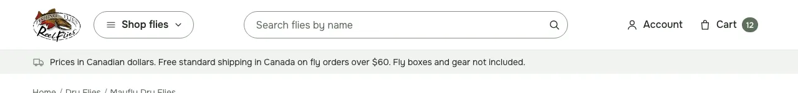 |

| Spike, 375 | Reference, 375 |
|---|---|
|  | 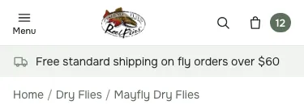 |

- **Matches:**
  - one row: the logo, "Shop flies", the pill search field, Account and Cart
  - the phone row: Menu with its label, the logo centred, the search icon and the bag
  - the logo is a `<div>` on every page
- **Still off:**
  - "Shop flies" has a pale #E3E8E2 border, where the reference (and ticket 27) uses #879186.
  - The phone logo is 40 px tall, smaller than the reference.
  - The shipping strip isn't there. It is ticket 27's widget, outside the spike.
  - The cart count can't show, because a channel-1 cart would be a write.
  - Stock Cornerstone centres and underlines the breadcrumbs (finding 6).

### Product card in a category grid

| Spike, 1280 | Reference, 1280 |
|---|---|
| 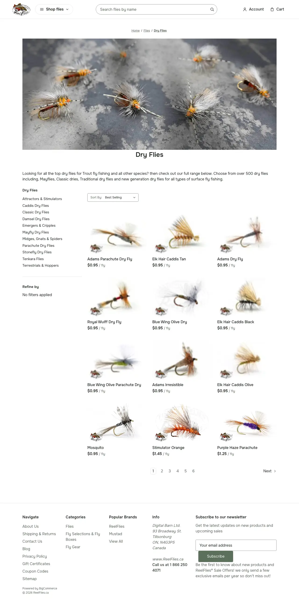 | 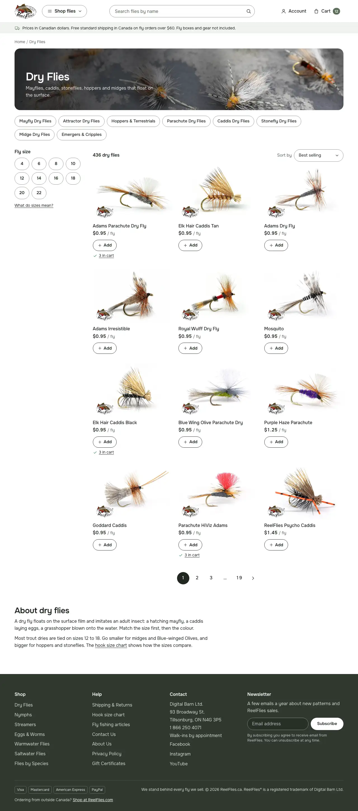 |

| Spike, 375 | Reference, 375 |
|---|---|
|  | 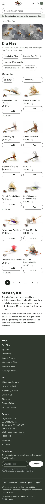 |

- **Matches:**
  - the photo on white, as shot, in a 3:2 box
  - the name clamped to two lines
  - the price with "/ fly"
  - three columns beside the sidebar, and two on phones
- **Still off (other tickets' parts):**
  - the listing header: banner, chips and the plain header (32)
  - the size filter pills (33)
  - "+ Add" (43) and "3 in cart" (42)
  - the pager (32)
  - the description split (32)
  - the footer (50)
- **On phones,** the stock sidebar puts the sub-category list and the filter box above the first card (finding 7).

### Product page

| Spike, 1280 | Reference, 1280 |
|---|---|
| 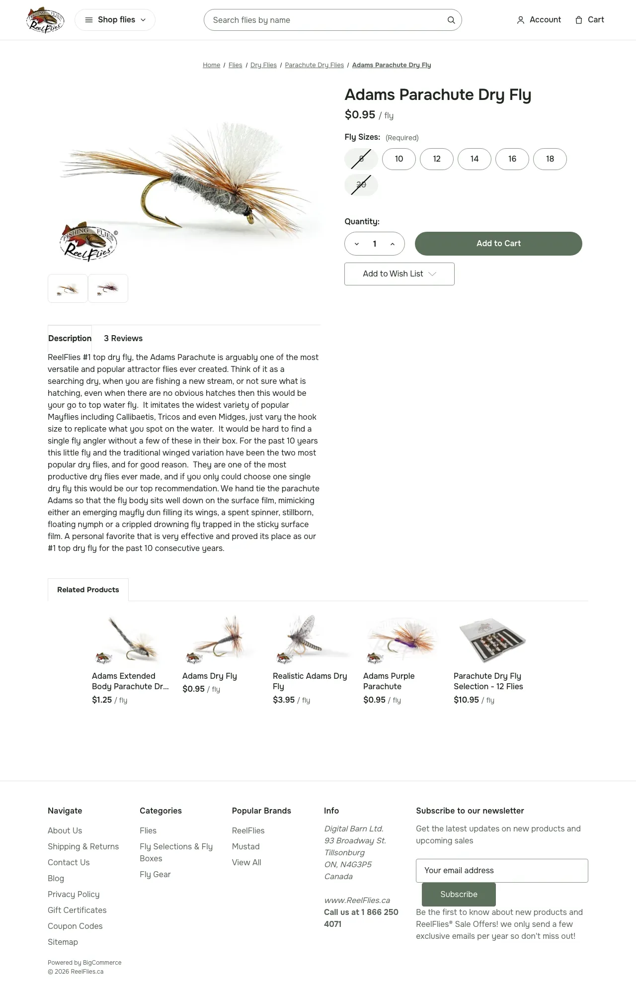 | 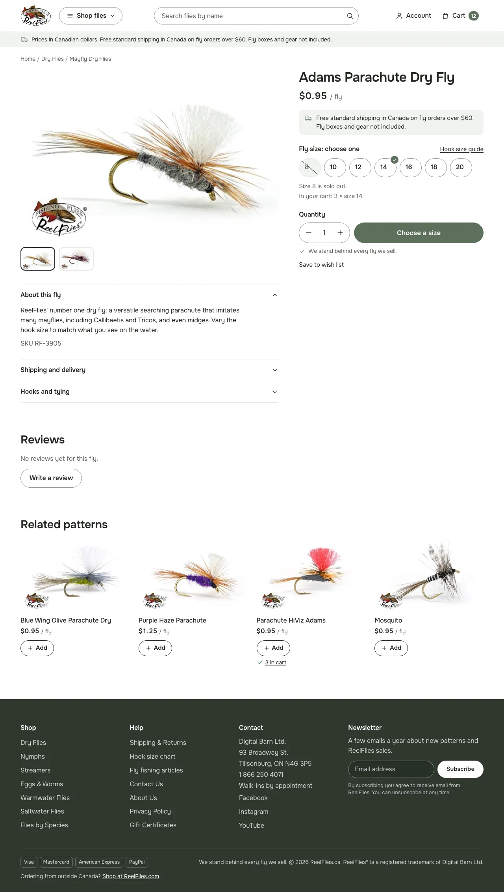 |

| Spike, 375 | Reference, 375 |
|---|---|
|  | 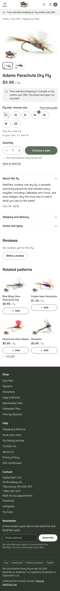 |

- **Matches:**
  - the gallery on the left with the details under it, and the buy box on the right
  - on phones: the photo, then the buy box, then the details
  - the title and the price with "/ fly"
  - size pills with nothing preselected and the sold-out sizes struck
  - quantity 1 and a full-width buy button on one row
- **Still off:**
  - The size label is the stock "Fly Sizes: (Required)". There's no "Hook size guide" link and no sold-out line (37).
  - The stock strike runs past the pill's edges (finding 8).
  - The stepper uses the stock chevrons, not − and +.
  - The button reads "Add to Cart", not "Choose a size" (38).
  - The wish list is the stock dropdown button (39).
  - There's no shipping line or promise line (39).
  - The details are the stock tabs, not three `<details>` sections (39).
  - Related products are the stock carousel of five (39).
  - The active thumbnail has no ink ring (39).

### Cart

| Spike, 1280 | Reference, 1280 |
|---|---|
| 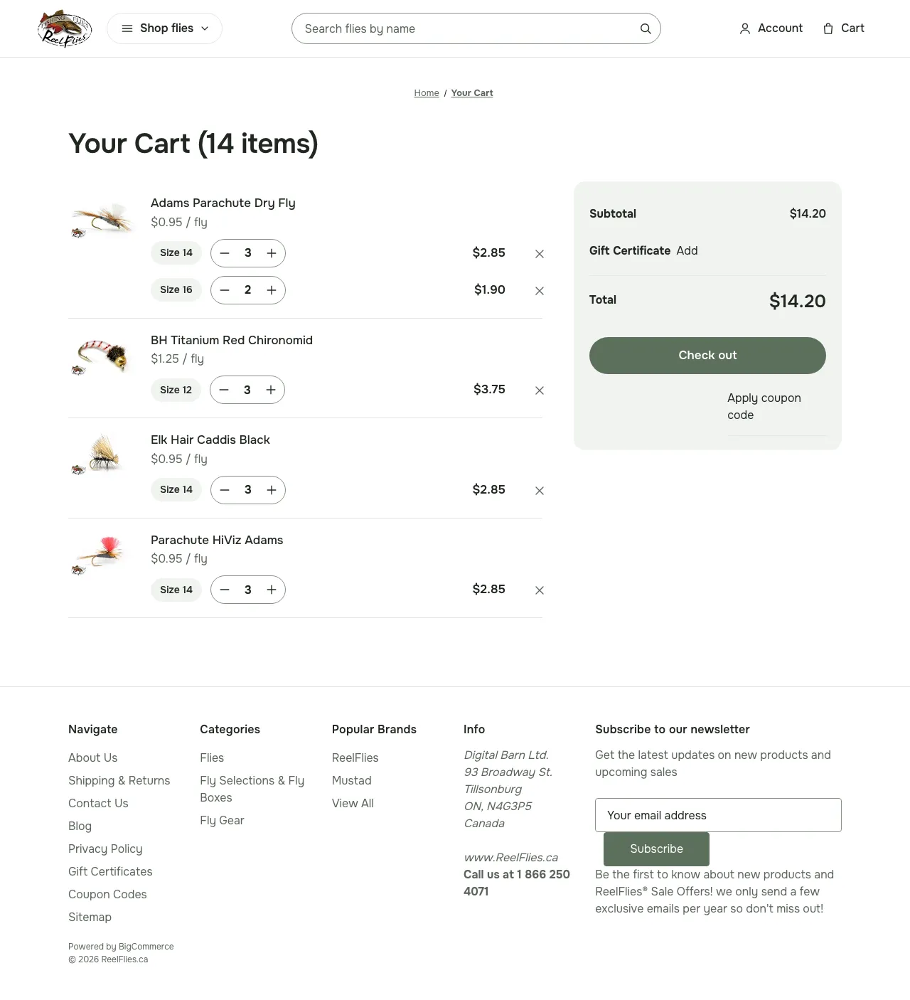 | 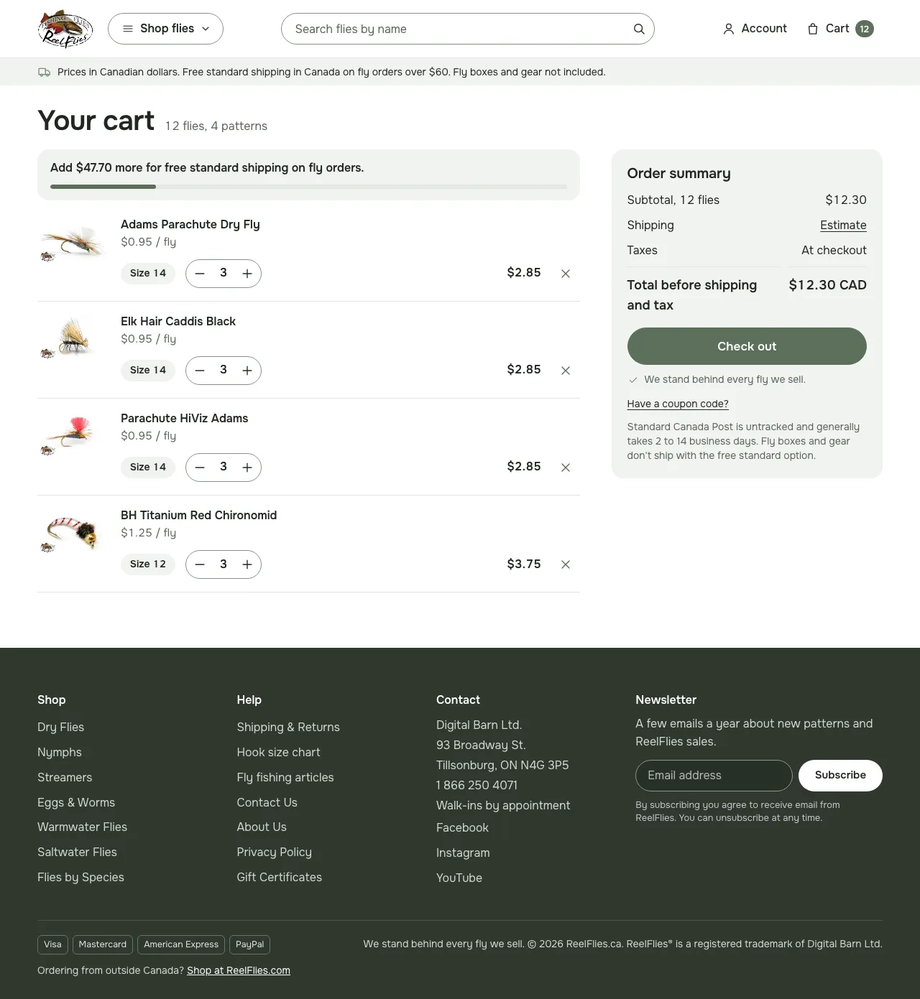 |

| Spike, 375 | Reference, 375 |
|---|---|
| 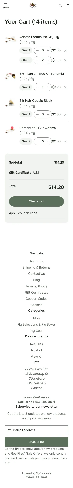 | 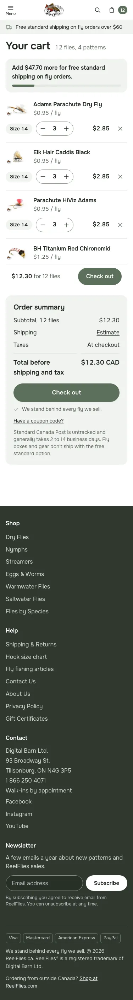 |

- **Matches:**
  - lines grouped by pattern: the photo, name and unit price once, then a row per size with its chip, stepper, line total and remove button
  - the summary as a tile panel beside the lines, with a full-width Check out
- **Still off:**
  - The heading is the stock "Your Cart (14 items)", not "Your cart · 14 flies, 4 patterns".
  - There's no free-shipping line (41).
  - The patterns are in name order, not the order they were added (finding 3).
  - The summary is stock: a "Gift Certificate Add" row, the coupon link floated right at 1280, and no Shipping or Taxes rows (41).
  - There's no promise line and no sticky phone bar (41).
  - At 375 the line total touches the stepper.

## Inherit list

"Take" means the ticket can copy the code or the approach from `spike/26-skin`. "Rebuild" means it can't, and says why. Every spike file carries a `SPIKE (ticket 26 …)` header. The ticket that rebuilds a file drops that header.

### 27 · Header

- **Take:**
  - **One hook.** `{{> components/reelflies/header}}` replaces the stock `<header>` element, lines 13–32 of `templates/components/common/header.html`. The `header_navigation_bottom--global` region moves inside the partial, before `</header>`.
    - The spike didn't need `navigation.html` at all: the partial owns Account and Cart. 27 lists both files, so it may register one hook fewer. Check that against 30 first.
  - **The markup skeleton:**
    - a CSS-grid row of Menu, the logo, Shop flies, search and the user nav
    - the logo in a `<div>` on every page type
    - `#menu`, with the stock `navigation-menu` inside, kept in the header
  - **The Menu button.** A real `<button data-mobile-menu-toggle="menu">` works with stock `mobile-menu-toggle.js`. At 375, a tap set `aria-expanded="true"` and opened the drawer, with no console errors on the product and category pages at either width. 27 keeps the stock toggle and adds Escape and the Menu/Close label.
  - **`_header.scss`:**
    - `body { padding-top: 0 }`, which undoes the stock fixed 55 px bar
    - the sticky header
    - the 56 px phone row
    - the Shop flies pill and the search pill
    - Account's label hidden below `medium`
    - the count pill on `.countPill.cart-quantity`
  - **Icons and strings.** The `menu` and `chevron-down` icons, and the `reelflies.header` strings (`menu`, `shop`, `search_label`, `search_placeholder`, `user_label`).
- **Rebuild:**
  - **The search form.** The spike's inline form becomes `components/reelflies/search-form.html` under section 6.9's contract (unique ids, `name="search_query"`, no `data-search-quick`). Add the phone search row's empty slot for 30. The spike's phone toggle points at a field that isn't on screen.
  - **The Shop flies border:** #879186, as the ticket says. The spike used `--rf-tile-2`.
  - **The breakpoints.** The spike switches everything at Cornerstone's `medium` (801 px). 27 keeps Account's label down to a 900 px container.
  - **Tokens for sizes.** Use `--rf-target-buy` and `--rf-target-row` where the spike hard-coded 44 and 48 px, and the header height token from finding 9 for `scroll-padding-top`.
  - **The logo size:** 78 px wide until ticket 14's master. The spike sized it at 40 px tall on phones and 56 px on desktop.
- **Left open:**
  - **The cart count with items.** The spike relies on stock `cart-preview.js` to set `countPill--positive` after `cart-quantity-update`. That wasn't seen with items in the cart. Test it with a mocked cart.
  - **The interim desktop menu** (finding 2).
  - **The strip, the rise ring and `rf_rise`:** not in the spike.

### 31 · Product card and grid

- **Take:**
  - **The price hook.** One line in `card.html` (line 130): `{{> components/reelflies/price-unit}}` after `components/products/price`. Section 6.2 makes 31 the owner of `price-unit.html`.
  - **The grid in `_card.scss`:**
    - `.productGrid` as a CSS grid, 2 columns then 3
    - the stock `grid-row` clearfix pseudo-elements turned off, or they take the first and last cells
    - both stock width rules overridden: `.productGrid .product` and `.page-sidebar + .page-content .productGrid .product`
  - **The card:**
    - the name clamped to two lines
    - the price with "/ fly" on one baseline
    - the rating row hidden
    - the photo with `object-fit: contain`
- **Rebuild:**
  - **Don't take the hidden actions.** The spike's `.card-figcaption { display: none !important }` broke ticket 16's Quick view check (finding 1). 31 keeps the stock actions and makes them reachable on phones.
  - **The 3:2 box.** The spike overrides the box with `padding-bottom: 66.6667%` on the image container. 31's route is `productgallery_size` 600x400, which also fixes the image requests.
  - **The price unit's rule.** `price-unit.html` shows "/ fly" on every product. 31 adds the interim Placement rule and `rf_price_unit_exclude`.
  - **Not in the spike at all:**
    - the eager first row with `srcset`, `sizes` and `fetchpriority`
    - the sold-out badge
    - removing the brand line and the compare checkbox
- **Left open:** none beyond the ticket.

### 37 · Size pills

- **Take:**
  - **The approach.** `_size-pills.scss` restyles the stock `set-rectangle` option with no markup change, and the stock option-change JS still drives it:
    - choosing 14 checked its radio
    - the sold-out sizes came from the stock `.unavailable` class
  - **The pill:** the edge border, the pill radius, and the sold-out pill on tile.
- **Rebuild:**
  - **The selected state.** The spike fills it solid ink. The ticket wants a 2 px ink border on #F1F3F0, ink text and a check, because Add to cart stays the only solid button.
  - **The size.** Pills are 56x48. The spike's are 44 px tall with a 50 px minimum width.
  - **The strike** (finding 8).
  - **`size-pills.html`** through the `set-rectangle.html` hook:
    - the "Fly size: choose one" label
    - "Hook size guide"
    - the radiogroup and a unique id
    - the sold-out line
    - visible on the server
- **Left open:** hook order waits on ticket 18, as the ticket says.

### 38 · Add flow

- **Take:**
  - **The buy row.** `_add-flow.scss` puts the stepper and the button on one row with a grid on `.add-to-cart-wrapper`. That needs the selector `.productView-options .form .add-to-cart-wrapper`, because stock sets the wrapper's `display` there.
  - **The button:** the buy colour, the pill radius, 48 px tall and full width.
  - **Wallet buttons** on their own full row.
- **Rebuild:**
  - **The stepper icons.** The stock stepper draws the sprite's chevrons, so − and + need 38's `add-to-cart.html` hook.
  - **Not in the spike:** the "Choose a size" and "Add N to cart" labels, the inline confirmation, the error guards and the sticky phone bar.
- **Left open:** none beyond the ticket.

### 39 · Product page layout

- **Take:**
  - **The layout.** `_product.scss` uses grid areas on `.productView:not(.productView--quickView)`: images, data, options, then the description. From `medium` the description sits under the photos.
    - It needs no markup move.
    - It leaves Quick view's modal on the stock layout.
    - It undoes the stock floats, the clearfix and the centring on phones.
  - **The title size,** interpolated for libsass (finding 9).
  - **Hidden:** the rating, SKU and share rows.
  - **The thumbnail tile style.**
- **Rebuild:**
  - **The sticky buy box** (finding 4).
  - **The details.** The spike only restyled the stock tabs. 39's three `<details>` come through `description-tabs.html` and `tabs.html`.
  - **Related products.** Stock renders them as a slick carousel with arrows and dots on phones. 39 replaces it with 31's grid under "Related patterns".
  - **The main image.** The 3:2 box comes from `product_size` 760x507 and 39's main-image partial, not from the spike's `padding-bottom` override.
  - **The active thumbnail ring.**
  - **Not in the spike:** the shipping line, the promise line and "Save to wish list".
- **Left open:** the breadcrumb style (finding 6).

### 41 · Cart

- **Take:**
  - **The grouping.** `templates/components/reelflies/cart-lines.html` groups the lines on the server:
    - `withSort cart.items "name"` puts each pattern's lines together.
    - `assignVar` and `getVar` on `product_id` open a group whenever the product changes.
    - It renders through a hook in `cart/content.html`, which 41 already lists.
    - Stock `cart.js` re-renders `cart/content` after each change, so the groups survive a refresh with no client-side regroup and no layout shift.
  - **The stock attributes stay,** so `cart.js` still finds its controls: `data-cart-update`, `data-cart-itemid`, `data-action`, `.cart-item-qty-input`, `.cart-remove` and `data-cart-quantity`.
    - Not exercised in a browser: a quantity change is a cart write. 41 tests it with 38's route fixtures.
  - **The cart fixture** (`scripts/qa/spike-26/screens.mjs`): a full cart page with no live cart. It is 41's fixture DOM, and 42 can reuse it.
  - **The two-column layout.** A grid on `.page-content[data-cart]`, the lines left and the summary right, with dense packing. It places the stock siblings (title, lines, coupons, totals, region, actions) without moving markup.
  - **The panel and the rows:** the tile panel, the Check out button, and the size row (chip, stepper, total, remove), with a 64 px photo on phones.
- **Rebuild:**
  - **The order** (finding 3):
    - The spike's groups come out in name order.
    - Sizes inside a group stay in the order they were added.
  - **Other options.** The spike prints the first option as "Size {value}", which is wrong for 5663's Colour.
  - **Unit prices per size** where they differ (Kaufmann's Golden Stone). The spike prints the unit price once per group.
  - **Dropped line types:** gift certificates, non-physical lines, the "Change" link for configurable lines, release dates and brand.
  - **The remove label:** "Remove {pattern}, size 12". The spike uses the stock "Remove {name}".
  - **The hook itself.** The spike wraps the stock table in `{{#if false}}`. 41 needs a proper hook.
  - **At 375,** the row needs room between the total and the stepper.
  - **The summary:**
    - "Order summary"
    - the Shipping row with the estimator
    - Taxes "At checkout"
    - "Total before shipping and tax" with CAD
    - the coupon link under Check out
    - no Gift Certificate row
    - the promise line
  - **Not in the spike:**
    - the count in flies (`page-title.html`)
    - the free-shipping message (`status-messages.html`)
    - the sticky phone bar
    - the error guards
- **Left open:** the order (finding 3).

## Findings that change the plan

Each finding names the ticket that absorbs it.

1. **Hiding the card's stock actions breaks a gate, so 31 must keep them.** With `.card-figcaption` hidden, ticket 16's check "Quick view opens from a card, and its chunk loads only on the first click" failed at 1280 in the spike's harness run. 31 already keeps the stock actions working and reachable on phones, so it must not take the spike's rule. 43 changes them only behind `rf_quick_add`. **Absorbed by 31 (and 43).**
2. **The one-row header removes the stock desktop menu that a W0-8 state opens.** The spike hides `#menu` from `medium` up, so the "desktop menu panel, open on the first top-level category" state had nothing to open. Its axe check and its screenshot both failed at 1280 in the spike run. 27 merges before 28, so it has two options:
   - keep the stock panel reachable on desktop, for example with Shop flies opening the stock navPages as an interim
   - agree with the orchestrator that the state and its baselines move to 28

   **Absorbed by 27, with 28.**
3. **The cart can group on the server, so 41's client regroup is optional.** `cart-lines.html` groups on the server through the `cart/content.html` hook, and it survives `cart.js`'s re-render. That removes the layout-shift risk 41 plans around (`cart-groups.js` regrouping after paint). Two parts stay open:
   - **Pattern order:** `withSort` gives name order, but the reference shows the order each pattern was first added. A nested `{{#each}}` that opens a group only at a product's first line would give first-added order in Handlebars. It wasn't tried.
     - **Default taken (revisitable):** first-added, as the reference shows it.
   - **Size order inside a group:** sizes stay in the order they were added. Hook order inside a group still needs 41's script with the shared `facet-order.js`, now moving rows of equal height inside one group, or a reserved height.

   **Absorbed by 41.**
4. **The sticky buy box needs one wrapper.** Grid areas give the reference layout without moving markup. But the title and price (`.product-data`) and the options (`.product-options`) are separate grid items, so `position: sticky` can't hold the whole buy box. Either wrap them in one element through 39's `product-view.html` hook (already listed), or make only the options sticky. **Absorbed by 39.**
5. **The hooks: no new upstream files, but the expected list undercounts.** The spike used four upstream hooks: `header.html`, `card.html`, `product-view.html` and `cart/content.html`. Each is already in its ticket's file list, and nothing beyond those lists was needed.
   - `navigation.html` may need no hook (27).
   - 41's own ticket names seven upstream files (`pages/cart.html`, `content.html`, `totals.html`, `coupons.html`, `page-title.html`, `status-messages.html` and `cart.js`). `CUSTOMIZATIONS.md`'s "Expected hooks" lists three of them.

   The count on ticket 02 should come from the tickets' file lists. 25–30 is an estimate, not a cap (plan 6.5). **Absorbed by 02 (the orchestrator's count) and 27.**
6. **No ticket owns the breadcrumbs' look.** Stock centres the breadcrumbs, underlines them and sets them small. The reference has them left-aligned, in dun, with no underline, and none on the cart. 32 keeps stock breadcrumbs on category pages, so 32 restyles them for every page and 39 checks the product page. 41 hides them on the cart, as the spike did. **Absorbed by 32 (+0.25 day), with 39 and 41.**
7. **On a phone, the first card starts below the stock sidebar.** At 375, the sub-category list and the filter box come before the first card, which then starts about 1,100 px down. The box's heading also reads "Browse by &": the stock heading in `faceted-search/index.html` joins the facets' titles, and they come out empty on channel 1. 32's chips replace the list and 33's filter replaces the box. 33 also covers the no-facet heading in its empty state. **Absorbed by 32 and 33.**
8. **The stock sold-out strike is sized for the stock square.** It is a `::before` at `left: -5px; top: 11px` (`citadel/forms/_forms.scss:403-417`), so on a pill it runs past both edges. The spike's added `line-through` marks it twice. 37 draws its own diagonal inside the pill in #5A645A and turns the stock one off. **Absorbed by 37.**
9. **Tokens to feed back into 25:**
   - **Radii.** The reference uses a 12 px radius eleven times and 8 px four times, and 25 has only 16, 20 and 999 px. Add `--rf-radius-small` (8 px) and `--rf-radius-mid` (12 px).
     - 12 px: the product thumbnails, the cart photo, the callouts and status lines, and the home tiles.
     - 8 px: the logo's link and the quick-search thumbnails.
     - The spike's 8 px thumbnails should be 12 px.
   - **The header's height,** as a token (`--rf-header-h`: 56 px on phones). 27 uses it for `scroll-padding-top`, and 38 for the sticky bar's offsets.
   - **Use the existing target tokens.** `--rf-target-buy` (44 px) and `--rf-target-row` (48 px) exist but the spike hard-coded them. The rebuilds use the tokens.
   - **libsass and `clamp()`.** The theme's Sass (libsass, through stencil-cli) tries to do the arithmetic inside `clamp()` in a property value and fails on mixed units (`cqi` + `px`). The build failed until the spike wrote `#{"clamp(26px, 1.4cqi + 14px, 34px)"}`. 25's tokens sidestep it by living in custom properties. A product title size would too: `--rf-fs-title` beside `--rf-fs-h1`.

   **Absorbed by 25 (a follow-up), or by whichever of 27 and 39 lands first, in `_foundation.scss`.**
10. **The docs PR isn't "docs-only" to `merge.sh`.** `isDocsOnly` counts only `.md` files and `docs/`, so the WebP screenshots under `research/26-skin-spike/` make this PR need the three sign-offs, not `rf/review` alone. **For the orchestrator:** spawn the three reviewers, or teach `merge.sh` that images beside a research note are docs (a guarded tooling change).

Seen in the harness run but not caused by the spike, so not a finding:

- **`reduced-motion.spec.mjs`** (54a's `qa:motion`) failed on product, category and page with "127 declarations would move under reduced motion…", mostly from stock nav and loading-overlay transitions.
  - It isn't in `qa:prepush` or CI, and the spike didn't run it against `master`.
  - Ticket 54 should check whether 25's reset clears it on `master`.
- **The screenshot gates failed on product, category and page,** because the spike changes the look and re-recorded nothing.

## Re-estimate

### Time per screen

The spike's own wall-clock time, from the run's tool log on 2026-10-07 (PDT):

| Step | From | To | Time | Breakdown estimate for the ticket that finishes it |
|---|---|---|---|---|
| Setup: the worktree, `npm ci`, `stencil start` on channel 1, the token check, the reference screens (5.5 minutes of that is the harness shooting them), the shooter and the cart fixture | 13:52 | 14:02 | 10 min | |
| Header | 14:02 | 14:06 | 4 min | 27: 2–3 days |
| Card in a category grid | 14:06 | 14:08 | 1.5 min | 31: 0.75–1 day |
| Product page (pills, add row, layout) | 14:08 | 14:11 | 3.5 min | 37 + 38 + 39: 3.5–5.75 days |
| Cart | 14:11 | 14:15 | 3.5 min, plus about 1 min of the fixture in setup | 41: 2–3 days |
| Checks, the harness spec and its run, the branch push | 14:15 | 14:21 | 6 min | |
| This note, the PR and its gates | 16:57 | | (a second session, after the wave's pause) | |

Each screen took minutes, not days, but that isn't the measure of a ticket.

- **What the spike did:** a first look pass, in CSS on stock markup, with four one-line hooks.
- **What it skipped:**
  - tests at the spec's seams
  - JS behaviour
  - switches
  - accessibility work
  - three sign-offs, rebases and baselines
- **What it measured instead:** where Cornerstone fights the design. The ticket estimates below move on that.

### Per ticket, against the breakdown

| Ticket | Breakdown | Revised | Why |
|---|---|---|---|
| 27 | 2–3 | 2–3 | Less: one include and the stock toggle are enough, and `navigation.html` may need no hook. More: the interim desktop menu (finding 2). |
| 31 | 0.75–1 | 1–1.25 | Keeping the stock actions (finding 1); two stock width rules and the clearfix to undo. |
| 37 | 1–1.5 | 1–1.5 | The stock option JS drives a CSS-only restyle; the strike (finding 8) is small. |
| 38 | 1.5–2.5 | 1.5–2.5 | Only the wrapper's specificity fought. |
| 39 | 1–1.75 | 1.25–2 | The sticky wrapper (finding 4); the carousel becomes a grid. |
| 41 | 2–3 | 2.5–3.5 | The stock totals and coupons fought the panel; the line types and options the spike dropped; the order (finding 3). Server-side grouping saves the layout-shift work. |
| **Six tickets** | **8.25–12.75** | **9.25–13.75** | +1 day |

### Total before the Flip

The breakdown's tickets 15–57 come to 54–83.75 developer-days. That figure counts 26 at 3, 53 at 2–3 and 56 at 0.5. The spec's 55–87 also counts 58 and 59, which come after the Flip.

| Change | Low | High |
|---|---|---|
| Breakdown, tickets 15–57 | 54.0 | 83.75 |
| 26 took about half a day (the spike, then this note and its review), not 3 | −2.5 | −2.5 |
| The six screen tickets, above | +1.0 | +1.0 |
| The breadcrumbs, in 32 (finding 6) | +0.25 | +0.25 |
| Work outside the breakdown that is still to do: 46b (the store's Handlebars v3), #44's reviewer follow-ups, and the W0-7 follow-ups (the stencil-start log, a retry on a start timeout) | +0.5 | +1.0 |
| **Revised, before the Flip, counting 53 and 56** | **53.25** | **83.5** |

- **The total:** about **53–84 developer-days before the Flip**, plus owner time. With 58 and 59 it is about 55–87, the same as the spec's figure. The spike moved work between tickets but didn't change the total.
- **Built so far:** about 12–19.5 of those days.
  - Tickets 15–18 and 21–25, 46, and this ticket are built.
  - Most of them wait only on Shaun's approvals, the preview cookie or a checkpoint push.
- **Left:** about **42–64 developer-days**.

### Agent waves and review cycles

The calendar comes from how waves actually run, not from developer-days.

- **Wave 0:** 12 tooling PRs (W0-12 is Shaun's sitting), none of them in the breakdown. They were built and merged in about 8 hours (2026-10-06 16:59 to 2026-10-07 00:40 UTC), and the follow-ups by 06:00.
- **Wave 1 and lane G:** 17 PRs, about 10–17 of the breakdown's days, merged in about 9 hours (2026-10-07 03:43 to 12:26 UTC).
  - **Time from opening a PR to merging it:** a median of 2.5 hours, from 16 minutes to 8.4 hours.
  - **The slowest ticket was the hero (46).** It took three review rounds and a refused store write, and its follow-ups ran to 20:49.
- **Checkpoint 01** needed a second try at the push. The push itself takes about 13 minutes.
- **So the agents' throughput** is about 1–2 breakdown days per hour of wall-clock, across four to six lanes.
- **What sets a wave's length isn't agent time.** It is three things:
  - the serialized merge queue, where each header or footer ticket rebases and re-records in order (27 → 50 → 28 → 29 → 30)
  - the review rounds
  - Shaun's checkpoint review and the fix tickets it makes

The waves left before R1 hold about 32–50 of the revised days:

| Wave | Tickets | Revised days |
|---|---|---|
| 2 | 27–30, 50, 47 | 9–13.75 |
| 3 | 31–33, 35, 37, 38, 41 | 9.75–14 |
| 4 | 34, 36, 39, 40, 42, 43, 48, 49, 51 | 9.25–14.75 |
| 5 | 44, 45, 52 | 4.5–7 |

- **The projection:** 2–3 days of agent time per wave, then Shaun's review, so about a week per wave. Waves 2–5 then end in the first half of November, and the fix tickets and second passes by late November.
- **What it replaces:** ticket 10's guess of 1.5–2 weeks per wave, finishing in mid-December.
- **The theme build is now 2–4 weeks ahead of refactor 14.** It is off the critical path. The refactor path and owner time decide T-35.

### Refactor 14 and T-35

- **Refactor 14's expected date is unchanged: Thu 2026-12-10.**
  - The range runs from about Tue 2026-11-24 to mid-January 2027.
  - For a Feb 16 Flip, the latest is about Fri 2026-12-18.
- **Why it hasn't moved:**
  - The refactor workspace's `map.md` and issues haven't changed since 2026-09-07.
  - Its first step, Shaun's approval of theme ticket 03's amendment (`plan/approvals/03-refactor-amendment.md`), is still waiting.
  - The Dec 10 path needs that approval by about Fri 2026-10-16, and refactor 18's probes by about Fri 2026-10-23, which need Shaun's go.
- **From refactor 14 to code complete:**
  - R2 takes about 1.5 weeks.
  - Wave 6's owner half takes about a week.
  - Dec 21–Jan 1 counts at half capacity.
  - So code complete lands in the first week of January. Feb 16's T-35 is Tue 2027-01-12, so that leaves about a week of float.
- **The theme waves end before refactor 14 lands,** so T-35 depends only on refactor 14 and the owner steps after it.

### What it means for the Flip date

- **Keep Tue 2027-02-16 as the provisional date.** The re-estimate doesn't move it, so `scripts/release-calendar.json` needs no change until Shaun sets the date.
- **Feb 9 is still the stretch.** The theme no longer limits it, but it needs refactor 14 by about Fri 2026-12-11 with no slip. That needs the refactor path restarted now.
- **A January Flip is still out.** Even the optimistic Nov 24 would put T-28's channel-1 push and the code freeze in the holiday weeks (ticket 10).
- **The weekly order count is still missing.** Nothing new is in `report/market-analysis/` since ticket 10's comment, so the February window still rests on the critical path and the season, not on measured order dips.

## Unfinished

This was one pass per screen, as the box allowed. Everything above under "Still off" and "Rebuild" is unfinished, and the tickets named there finish it. The spike also didn't do these:

- **No behaviour:**
  - the drawer's content and the panels (28, 29)
  - Escape and the Close label (27)
  - the search toggle's row (30)
  - the size pill script (37)
  - the add flow's JS and sticky bar (38)
  - the cart's error guards and sticky bar (41)
- **No cart with items on a page with a header,** so the count pill and the rise ring weren't seen.
- **Not at all:** the shipping strip, the links row (decision 8: off), and Quick view's modal.
- **No tests at the spec's seams,** no switches, no baselines.
- **Shaun's review (AC2):** waiting. He reviews these pairs on checkpoint 02's review page, and his notes go below.

## Shaun's review

Waiting for checkpoint 02's review page (wave 2 exit). A question goes with it: is a spike on channel 1's tree-1 data good enough for this review, given that tree 4 and its products aren't on ReelFlies_CA yet?

## How to rerun

From a checkout of `spike/26-skin`, after the worktree setup in plan section 7 (`npm ci`, the linked `secrets.stencil.json` and the copied `config.stencil.json`):

```sh
QA_PORT=3400 QA_CHANNEL=1 QA_VARIATION='ReelFlies CA channel 1' \
  npx playwright test --config scripts/qa/playwright.config.mjs spike-26
```

- **What it writes:** the PNGs, to `scripts/qa/results/spike-26/`.
- **What else runs:** the filter doesn't stop the config's other specs, so their screenshot and Quick view failures show too. They come from the spike's changes (finding 1) and are expected.
- **Iterating by hand:** `scripts/qa/spike-26/shoot.mjs` shoots against a hand-started `scripts/qa/serve.mjs`.
